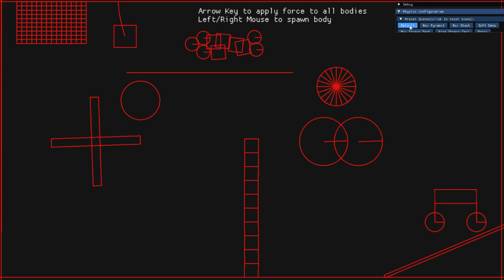
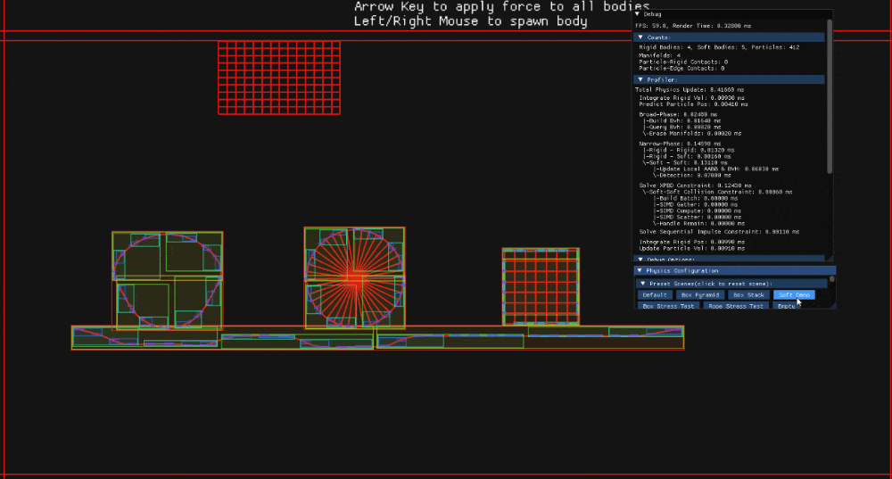
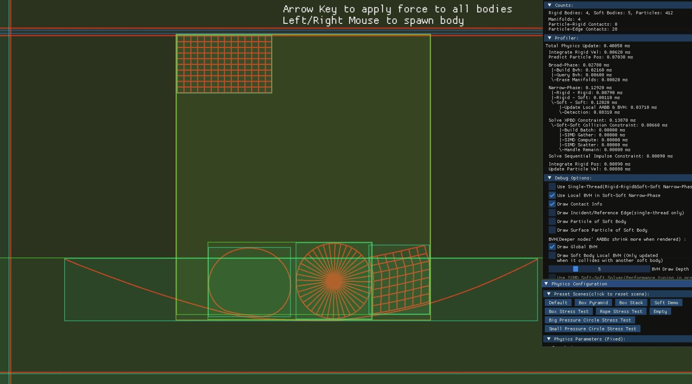
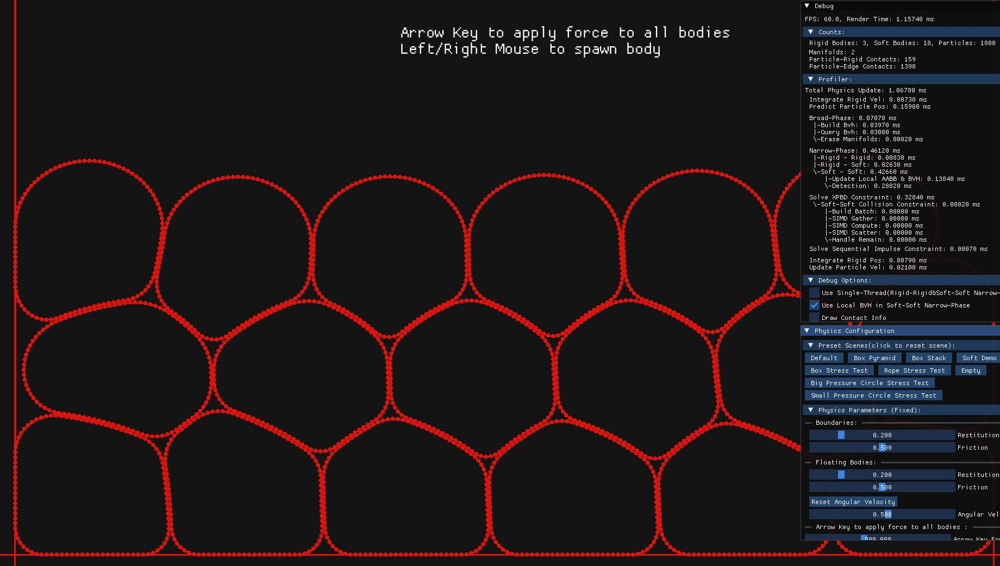
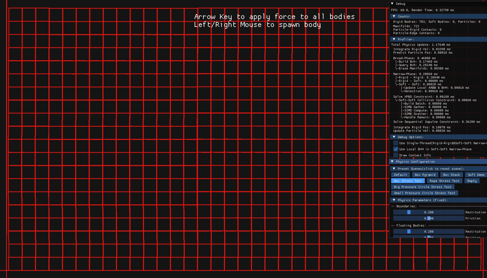
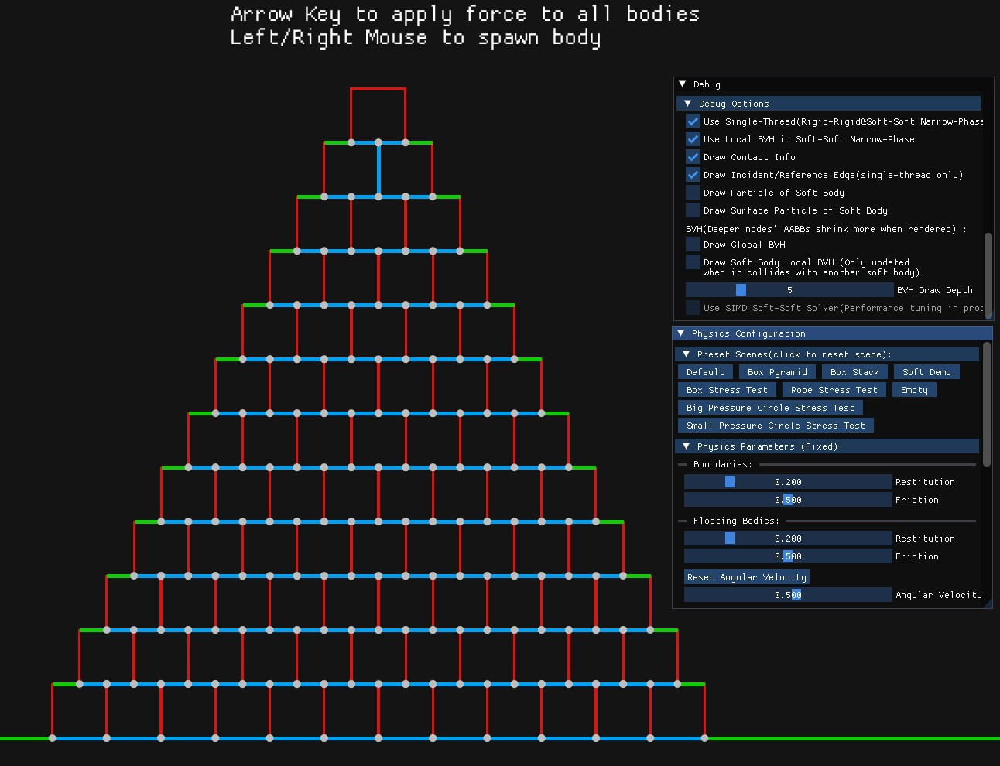
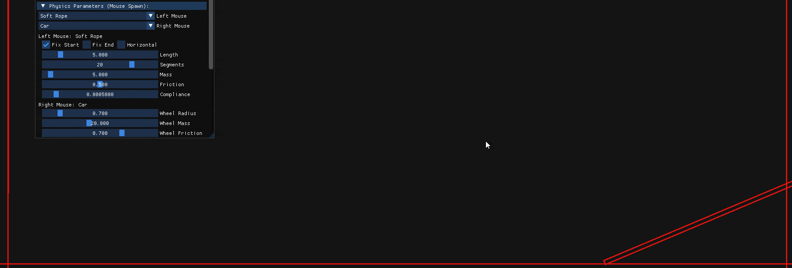
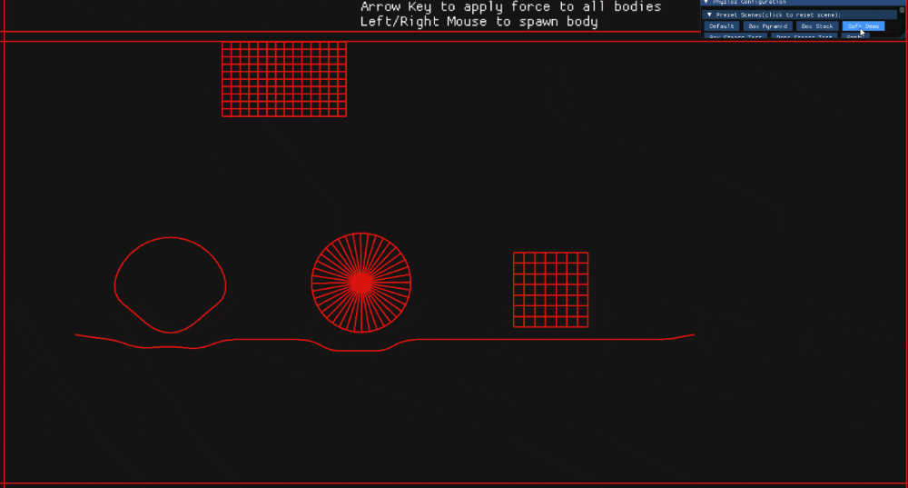

[English](README.md) | [日本語](README.ja.md)
# Unified Physics 2D

  
C++ で開発した、剛体（Rigid Body）とソフトボディ（Soft Body）の相互作用に対応する 2D 物理エンジン。

GJK / EPA による衝突判定、Persistent Manifold による接触情報の管理、Sequential Impulse および XPBD による拘束解法を実装。データ指向設計、階層的な衝突判定、並列化、メモリ管理の最適化に加え、数値的な退化ケースの解析と対策にも取り組んでいます。

**[Download Demo (Windows x64)](https://github.com/pinrui-lai/UnifiedPhysics2D/releases/latest)**

## Tech Stack

- **Language:** C++20
- **Collision Detection:** Morton Code、BVH、AABB、GJK、EPA、Clipping、SDF
- **Constraint Solver:** Sequential Impulse、XPBD、Warm Starting、Split Impulse
- **Constraint:** Joint、Angular、Area、Pressure、Contact、Collision、Distance
- **Performance:** SoA / AoS、`std::pmr`、`thread_local`、`std::atomic`、multithreading
- **Visualization:** Dear ImGui

## Physics Architecture

| 領域 | 実装 |
|---|---|
| Broad Phase | Morton Code を用いて構築したグローバル BVH。ソフトボディには全体のAABBをノードとして使用している |
| Rigid × Rigid | GJK / EPA / Clipping、Feature ID ベースの Persistent Manifold |
| Rigid × Soft | SDF による衝突判定。ソフトボディの表面粒子を対象に処理 |
| Soft × Soft | 表面粒子の AABB を各ノードに持つローカル BVH を構築し、AABB 同士の比較を行った後、表面粒子と表面エッジの交差判定を行う |
| Rigid × Rigid Solver | Sequential Impulse、Warm Starting、Split Impulse |
| Soft × Soft Solver | XPBD による拘束解法 |
| Rigid × Soft Solver | XPBD の \(\Delta\lambda\) を剛体への衝量に変換し、相互作用を解決 |

## Engineering Highlights

### データ指向設計：SoA / AoS の使い分け

データの連続アクセスを重視する処理には SoA を採用し、Narrow Phase や拘束ソルバーなど、ランダムアクセスが必要な処理では、キャッシュミスの発生を抑えるために AoS を採用する。

一律のレイアウトに統一せず、処理ごとのメモリアクセスパターンに応じてデータ配置を設計しています。

### ソフトボディ向けの階層的な衝突判定

<table>
  <tr>
    <th>Local BVHs</th>
    <th>Global BVH</th>
  </tr>
  <tr>
    <td width="50%">
      
    </td>
    <td width="50%">
      
    </td>
  </tr>
</table>

Broad Phase ではソフトボディ全体の AABB を用いてグローバル BVH を構築し、Narrow Phase では表面粒子の AABB を用いて各ソフトボディのローカル BVH を構築することで、さらなる衝突判定が必要な particle-edge ペアを絞り込む。

ローカル BVH の更新は Broad Phase で他のソフトボディとの重なりが判定された場合に限定し、不要な更新処理を抑制しています。

### 接触情報の継続管理

接触点に Feature ID を割り当て、Persistent Manifold でフレーム間の対応関係を管理。

対応する接触点の累積衝量を Warm Starting に利用し、接触状態が継続するシーンでの拘束解法の安定性を考慮しています。

### メモリ・演算コストの最適化

- `std::pmr::monotonic_buffer_resource` による一時メモリ確保コスト削減
- `std::execution` による拘束解法以外の並列化
- マルチスレッド環境で `thread_local` と `std::atomic` を活用し、メモリ確保を減らすとともに、共有メモリへのアクセスの安全性を確保する
- XPBD の角度拘束には、あらかじめ目標角度を方向ベクトルに変換しておく。これにより、角度拘束の評価時には、アンカーから粒子へのベクトルと目標方向ベクトルの外積を拘束関数 \(C\) として用いることができ、逆三角関数による角度の算出の計算コストを削減できる
- delta_time など、繰り返し除数として使用される値の逆数を事前に求めておき、以降の計算で乗算を利用することで、除算の実行回数を削減する
- 剛体の回転角度の正弦・余弦のキャッシュ
- Sub-Stepping による時間刻みの細分化
- `std::array` で GJK の Simplex、EPA の Polytope、BVH Query の Stack の一時データ管理、`std::vector` によるメモリ確保を減らす

<table>
  <tr>
    <th>Soft Circle Stress Test</th>
    <th>Box Stress Test</th>
  </tr>
  <tr>
    <td>
      
    </td>
    <td>
      
    </td>
  </tr>
</table>

以下の表は、上の左側の画像に示されている **Soft Circle Stress Test** の性能測定結果を示しています。

<table>
  <tr>
    <th colspan="3">Soft Circle Stress Test / CPU: AMD R5 5600</th>
  </tr>
  <tr>
    <th>Soft-Soft Detection</th>
    <th>Multithread</th>
    <th>Single thread</th>
  </tr>
  <tr>
    <th>Local BVH</th>
    <th>0.42ms</th>
    <th>1.20ms</th>
  </tr>
  <tr>
    <th>Brute Force</th>
    <th>0.76ms</th>
    <th>3.85ms</th>
  </tr>
</table>

## Technical Challenges

### 1. GJK の無限ループによる物理シミュレーションのフリーズ

**原因の調査・分析**

ステップトレースによる調査の結果、特定の衝突ケース（2つの Box の辺がぴったり接している）において、Simplex の辺長が極端に小さくなること（退化）で、次の探索方向ベクトル（Search Direction）の大きさが微小値となり、浮動小数点演算の精度限界による数値的不安定性が発生することを確認した。その結果、探索方向が適切に更新されず、GJK が無限ループに陥り、物理シミュレーション全体がフリーズする問題が発生していた。

**解決策**

epsilonによる閾値チェックを導入し、探索方向ベクトルの大きさが閾値を下回った場合にフォールバック処理で反復を強制終了することで、シミュレーションの安定性を向上。

### 2. Box Stacking の不安定

**原因の調査・分析**

自作の ImGui デバッグパネルを実装で Contact Normal（接触法線）および Incident Edge / Reference Edge（入射辺／基準辺）をリアルタイムで可視化して、衝突検出処理を解析した。

その結果、Grazing Contact（かすめ接触）が発生した際に、GJK が生成する Simplex が退化し、接触法線と貫通深度の算出に誤りが生じることを特定した。これにより、拘束ソルバーに不正確な接触情報が渡され、誤った Impulse を算出する。。

さらに、誤った接触法線は Clipping 処理にも影響し、入射辺と基準辺の選択を誤らせていた。その結果、現フレームの Feature ID が前フレームのものと正しく一致せず、対応する接触点の衝撃インパルスの引き継ぎができず、スタッキングが不安定になっていた。

**解決策**
同上、Simplex が退化した場合にフォールバック処理を適用し、Contact Info の計算精度を確保する。

<table>
  <tr>
    <th>Contact Info</th>
    <th>Spawn Bodies / Apply a force to left</th>
  </tr>
  <tr>
    <td width="55%">
      
    </td>
    <td>
      
      
    </td">
  </tr>
</table>

## Debugging & Visualization

Dear ImGui を利用したランタイム調整・デバッグ UI を実装。

- 物理パラメータのリアルタイム調整
- 物理処理の実行時間の確認
- BVH の階層構造の可視化
- Contact Point / Contact Normal の描画
- Incident Edge / Reference Edge の描画

衝突判定の中間状態を可視化し、数値計算の異常をアルゴリズムの各段階から調査できる環境を整備しています。
